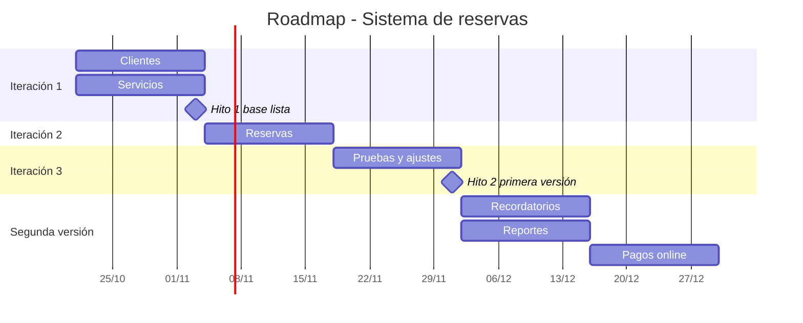

# Práctica aplicada: plan del proyecto (caso de reservas)

Autor: Juan César Retuerto Ibañez - U23208480
Equipo: Juan César Retuerto Ibañez, Alberto Joel Ramirez Ponte
Plazo de la empresa: sistema listo en 6 semanas (del 21/10/2026 al 01/12/2026)

## 1. Funcionalidades de la primera versión

| Funcionalidad | Prioridad inicial | Decisión | Justificación |
|---|---|---|---|
| Reservas | Crítica | Entra | Es el motivo del sistema. Sin reservas el cliente no puede operar. |
| Clientes | Alta | Entra | Una reserva necesita saber quién reserva. |
| Servicios | Alta | Entra | Una reserva necesita saber qué se reserva. |
| Recordatorios | Media | Segunda versión | Depende de que existan reservas. Mientras tanto se avisa manualmente. |
| Reportes | Media | Segunda versión | Necesita datos acumulados para ser útiles. |
| Pagos online | Baja | Segunda versión | Depende de una pasarela externa, tiene más riesgo y menor prioridad. El cobro sigue siendo presencial. |

La primera versión permite el flujo completo: registrar un cliente, elegir un servicio y reservar.

## 2. Hitos con fecha objetivo

| Hito | Fecha objetivo | Criterio de cumplimiento |
|---|---|---|
| Hito 1: base lista (Clientes y Servicios) | 03/11/2026 | Se pueden registrar y listar clientes y servicios sin errores. |
| Hito 2: primera versión entregada | 01/12/2026 | El flujo cliente, servicio y reserva funciona y fue probado con el cliente. |

## 3. Dependencias entre actividades

| Actividad | Depende de | Motivo |
|---|---|---|
| Reservas | Clientes | La reserva guarda el cliente que la hizo. |
| Reservas | Servicios | La reserva guarda el servicio reservado. |
| Pruebas y ajustes | Reservas | No se puede probar el flujo completo sin reservas. |
| Recordatorios (segunda versión) | Reservas | Se envían a partir de reservas existentes. |
| Reportes (segunda versión) | Reservas | Se calculan con los datos de reservas. |
| Pagos online (segunda versión) | Reservas y pasarela externa | El pago se asocia a una reserva y requiere la pasarela. |

## 4. Iteraciones

| Iteración | Fechas | Objetivo | Responsables |
|---|---|---|---|
| Iteración 1 | 21/10/2026 a 03/11/2026 | Clientes y Servicios | Juan (Clientes), Alberto (Servicios) |
| Iteración 2 | 04/11/2026 a 17/11/2026 | Reservas (crear, consultar y cancelar) | Juan y Alberto |
| Iteración 3 | 18/11/2026 a 01/12/2026 | Pruebas, ajustes y entrega de la primera versión | Juan y Alberto |

## 5. Roadmap

## 6. Riesgo y decisión de gestión

**Riesgo:** Reservas es crítica y depende de Clientes y Servicios. Si alguno de los dos se atrasa en la iteración 1, la iteración 2 no puede empezar y el plazo de 6 semanas se pone en peligro.

**Decisión de gestión:**
- Clientes y Servicios se desarrollan en paralelo, uno por integrante, con los campos mínimos acordados el primer día (cliente: nombre, documento y teléfono; servicio: nombre, duración y precio).
- Si el 03/11 alguno no está terminado, se recorta su alcance al mínimo y se mueve lo demás a la segunda versión, para no retrasar Reservas.
- Pagos online queda fuera de la primera versión desde el inicio, para no sumar el riesgo de una pasarela externa.

## 7. Explicación sobre la decisión

La empresa pide el sistema en 6 semanas y tenemos seis funcionalidades. Decidimos que la primera versión incluya solo Reservas, Clientes y Servicios, porque son las dos prioridades Altas y la Crítica, y juntas permiten el flujo completo de reservar. Recordatorios, Reportes y Pagos online dependen de que ya existan reservas, así que no pierden valor si esperan a la segunda versión.

Dividimos el trabajo en tres iteraciones de dos semanas. En la primera hacemos Clientes y Servicios en paralelo. En la segunda, Reservas. En la tercera, pruebas y entrega. Tenemos dos hitos: el 3 de noviembre, con la base lista, y el 1 de diciembre, con la primera versión entregada.

El riesgo principal es que Reservas depende de las otras dos. Si alguna se atrasa, todo se atrasa. Por eso decidimos acordar desde el primer día los campos mínimos de cada módulo, desarrollarlos en paralelo y, si el 3 de noviembre no están listos, recortar su alcance al mínimo en lugar de mover la fecha. Preferimos entregar poco y funcionando que mucho a medias.
